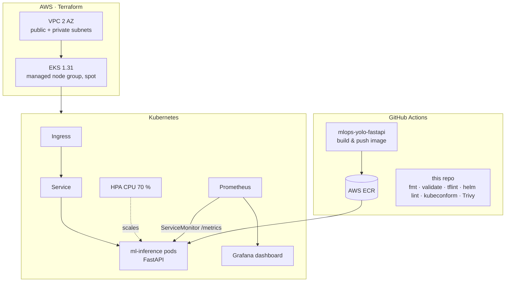

# ML platform on Kubernetes: Terraform (AWS EKS) · Helm · Prometheus/Grafana


Infrastructure as code and deployment layer for serving an ML model in production.
It provisions an AWS EKS cluster with Terraform, deploys the inference API built in
[mlops-yolo-fastapi](https://github.com/asmakerkouri/mlops-yolo-fastapi) with a Helm chart
(probes, autoscaling, PDB, Ingress), and monitors it with Prometheus + Grafana.
Everything can also run **locally on kind, without an AWS account**.

> 🇫🇷 Plateforme de déploiement d'un modèle IA : infrastructure AWS (VPC, EKS, ECR) en Terraform,
> chart Helm avec autoscaling, monitoring Prometheus/Grafana, CI de validation IaC et scan de sécurité.

## Architecture



## Repository layout

```
terraform/
  modules/network   VPC, subnets, NAT (terraform-aws-modules/vpc)
  modules/eks       EKS cluster + managed node group (terraform-aws-modules/eks)
  modules/ecr       ECR repository, scan on push, lifecycle policy
  envs/dev          environment composition, S3 remote-state backend (commented)
helm/ml-inference   Deployment, Service, HPA, PDB, Ingress, ServiceMonitor
monitoring/         kube-prometheus-stack values + Grafana dashboard (RPS, p50/p95 latency, detections)
kind/               3-node local cluster
scripts/            local-up.sh · load-test.sh · local-down.sh
.github/workflows/  ci.yml (IaC validation + security) · e2e-kind.yml (manual full deploy)
```

## Run it locally (kind, free)

Requirements: Docker, [kind](https://kind.sigs.k8s.io), kubectl, Helm.

```bash
./scripts/local-up.sh                 # cluster + monitoring + inference service
kubectl -n ml port-forward svc/inference-ml-inference 8000:80
./scripts/load-test.sh                # in another terminal
kubectl -n ml get hpa -w              # watch the autoscaler add pods
kubectl -n monitoring port-forward svc/monitoring-grafana 3000:80   # admin / admin
./scripts/local-down.sh
```

## Deploy on AWS

> ⚠️ EKS and NAT gateway are billed by the hour. Destroy the stack when you are done.

```bash
cd terraform/envs/dev
terraform init
terraform plan -out plan.tfplan
terraform apply plan.tfplan
$(terraform output -raw configure_kubectl)

helm upgrade --install inference ../../../helm/ml-inference -n ml --create-namespace \
  --set image.repository=$(terraform output -raw ecr_repository_url) --set image.tag=latest

terraform destroy
```

## Design choices

- **Community modules** (`terraform-aws-modules`) pinned by version, wrapped in thin local modules
  so environments stay short and consistent.
- **Private worker nodes**, public subnets only for load balancers; single NAT gateway and spot
  instances to keep the dev environment cheap.
- **Zero-downtime rollouts**: `maxUnavailable: 0`, readiness probe on `/health`, PodDisruptionBudget.
- **Least privilege containers**: non-root, no privilege escalation, all capabilities dropped.
- **Shift-left checks**: every PR runs `terraform fmt/validate`, tflint (AWS ruleset), `helm lint`,
  kubeconform schema validation, Trivy misconfiguration scan and ShellCheck.

## Author

**Asma Kerkouri** · DevOps & AI engineer · [LinkedIn](https://www.linkedin.com/in/asma-kerkouri-443b6815a)
